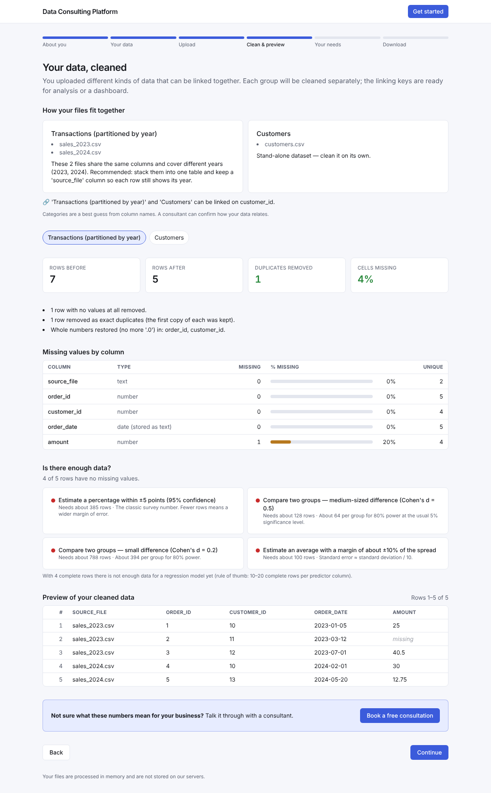

# Data Consulting Platform

An all-in-one data platform that **meets businesses where their data lives**.
Clients start as guests, answer the questions a data consultant would ask, upload
their files, and get clean data back automatically. When they want more
(analysis, dashboards, machine learning, data engineering), the platform quotes
it or books a call with a consultant.

Built to help underrepresented small, medium, and large businesses get started
with their data for little cost, while freeing the consultant for bigger,
higher-impact projects.

## What it does today (v0.1)

1. **About you** — individual or business
2. **Your data** — files on your computer (live), cloud storage / warehouses and
   business apps (coming soon → consultant hand-off)
3. **Upload** — CSV, TSV, TXT, Excel (every sheet), JSON, Parquet; one or many files
4. **Clean & preview** — multi-file categorization (same structure, split by
   year, or different kinds of data with join keys), automatic cleaning, a
   missing-value report per column, an "is there enough data?" check, and a full
   preview
5. **Your needs** — Data Strategy & Discovery, Exploration & Analysis,
   Visualization & Dashboards, Data Science & ML, Data Engineering, with a price
   estimate
6. **Download** — create an account (only now), download CSV or Excel; billed by
   processing minute

Client files are **processed in memory and never stored**.



## Tech stack

Based on the [Video_Game_Stats_Tracker](https://github.com/b-i-king/Video_Game_Stats_Tracker) template.

| Layer | Technology | Hosting |
|---|---|---|
| Web frontend | Next.js 16 (React 19, TypeScript, Tailwind CSS 4) | Vercel |
| Backend | FastAPI (Python), pandas | Render |
| Database | Supabase (PostgreSQL) via asyncpg | Supabase |

## Quick start

```bash
# Backend
pip install -r requirements.txt
uvicorn api.main:app --reload            # http://localhost:8000/docs

# Frontend (new terminal)
cd web && npm install && cp .env.example .env.local && npm run dev   # http://localhost:3000

# Tests
pytest -q
```

No database is needed for local development. See [docs/GETTING_STARTED.md](docs/GETTING_STARTED.md).

## Documentation

| Doc | What's inside |
|---|---|
| [docs/ARCHITECTURE.md](docs/ARCHITECTURE.md) | How the pieces fit, design decisions, hosting costs |
| [docs/CODE_MAP.md](docs/CODE_MAP.md) | File-by-file guided walkthrough |
| [docs/DATA_CLEANING.md](docs/DATA_CLEANING.md) | Exactly what happens to client files |
| [docs/PRICING.md](docs/PRICING.md) | Services, runtime billing, open decisions |
| [docs/GETTING_STARTED.md](docs/GETTING_STARTED.md) | Run it locally |
| [docs/DEPLOYMENT.md](docs/DEPLOYMENT.md) | Supabase + Render + Vercel |
| [docs/ROADMAP.md](docs/ROADMAP.md) | What's next (auth, payments, connectors, mobile) |
| [.claude/skills/README.md](.claude/skills/README.md) | Skills used on this project |

## Project layout

```
api/            FastAPI backend (core, models, routers, services)
db/schema.sql   Supabase tables
tests/          pytest suite
web/            Next.js frontend
docs/           documentation
.claude/skills/ project skills (data-cleaning, flat-file-intake, sample-size)
```

## License

MIT — see [LICENSE](LICENSE). The `sample-size` skill is adapted from Daniel
Rosehill's MIT-licensed work; see `.claude/skills/sample-size/LICENSE-NOTICE.md`.
