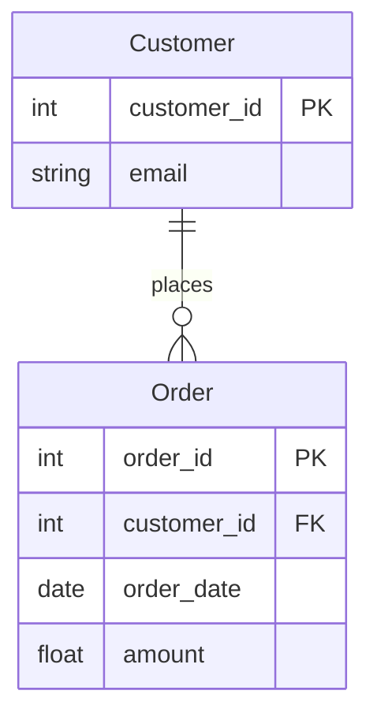

# ER Diagram (Data Engineering)

Turns "these files can be linked on customer_id" (from `flat-file-intake`) into
a verified, documented data model.

## Inputs

- Cleaned tables (DataFrames, files, or database tables).
- Optional: the `relationships` from the platform's categorization output.

## Procedure

### 1. Entities
One entity per distinct table/group. Name in singular PascalCase
(`Customer`, `Order`, `Product`).

### 2. Primary keys — verify, don't assume
A candidate key column must be **unique and non-null**:
```python
df[col].notna().all() and df[col].is_unique
```
If no single column qualifies, test pairs (composite key). If nothing
qualifies, note "no natural key — add a surrogate id".

### 3. Foreign keys — verify coverage
For a candidate link `child.col → parent.key`:
```python
orphans = ~child[col].dropna().isin(parent[key])
coverage = 1 - orphans.mean()
```
Report coverage; under 95% means the link is unreliable or the parent table
is incomplete — ask the client.

### 4. Cardinality
- `child.col` repeats → one-to-many (`||--o{`).
- unique on both sides → one-to-one (`||--||`).
- link table with two FKs → many-to-many through it.

### 5. Draw (Mermaid)

Types: use the cleaned dtypes (`Int64` → int, `float64` → float, dates →
date, text → string).

### 6. Deliver
`outputs/data-model/<client>-erd.md` with the diagram, a key-verification
table (column, unique?, null %, FK coverage), and open questions. Pair with
`data-dictionary-creator` for column-level documentation.

## Related skills
`flat-file-intake` (suggests links) · `data-dictionary-creator` (column docs) ·
`sql-queries` (DDL and queries against the model) ·
`type-consistency-sweep` (fix mismatched key types before linking).

## Run it (platform implementation)

This procedure is also runnable code: [`skill.py`](skill.py) in this folder (category: **Data Engineering**).

```bash
python -m data_skills run er-diagram samples/sales.csv samples/customers.csv
```

Web: **Explore your data → Run a skill → ER diagrams** (unlocked when the client chooses **Data Engineering**) · API: `POST /api/skills/er-diagram/run`.
Input: several tables (every file you pass).
