# Database design

One Supabase (PostgreSQL) database, in two layers:

| Layer | File | Holds | Status |
|---|---|---|---|
| **Platform** (`public`) | [`db/schema.sql`](../db/schema.sql) | Who signed up, teams, consultants, plans, subscriptions, consulting hours, consultations, storage consent, load runs, usage | ✅ Live (used by the API) |
| **Client data** (`warehouse`) | [`db/warehouse.sql`](../db/warehouse.sql) | Clients' own business data, for Data Engineering clients who opt in to managed storage | ✅ Live: loaded by Data Engineering → "Load into database" after a preview the client accepts ([DATA_MODEL.md](DATA_MODEL.md)) |
| **Planned** | (this page) | QuickBooks connections and syncs, AI usage caps | 📝 Proposed below |

**Set it up in one command** (or paste both files into Supabase → SQL Editor):

```bash
python scripts/setup_database.py            # runs schema.sql + warehouse.sql, then lists every table and its row count
python scripts/setup_database.py --check    # only lists (changes nothing)
```

Rule of thumb: **the platform layer never holds client data** (uploaded files
are processed in memory). Client data lives only in the warehouse layer, only
for clients who choose managed storage. See ARCHITECTURE.md → "Stateless processing".

Apply or update: Supabase → SQL Editor → paste `db/schema.sql` → Run. Every
statement is safe to re-run.

## Platform layer: ER diagram

```mermaid
erDiagram
    accounts ||--o| teams : "owns (team_role = owner)"
    teams ||--o{ accounts : "members (team_id)"
    consultants |o--|| accounts : "signs in as"
    consultants ||--o{ accounts : "manages (consultant_id)"
    accounts ||--o{ account_services : "project interests"
    accounts ||--o{ subscriptions : "pays for"
    subscriptions ||--|{ subscription_items : "tools in it"
    subscription_plans ||--o{ subscription_items : "plan_id"
    accounts ||--o{ consulting_purchases : "prepaid hours"
    accounts ||--o{ usage_events : "downloads"
    consultants |o--o{ usage_events : "done on the client's behalf"
    accounts |o--o{ intake_responses : "optional"
    accounts |o--o{ consultations : "free call, paid sessions"
    consultants |o--o{ consultations : "confirmed by"
    accounts ||--o{ storage_consents : "store my data"
    accounts ||--o{ load_runs : "loads into warehouse"

    accounts {
        uuid id PK
        text account_type "individual | business"
        text first_name
        text last_name
        text email UK
        text company_name
        uuid team_id FK
        text team_role "owner | member"
        text naics_sector
        text naics_subsector
        text industry_other "Other: what they typed"
        text company_size "LinkedIn A-I"
        text location_label
        bool wants_consultant
        uuid consultant_id FK "NULL unless wants_consultant"
        text stripe_customer_id UK
        uuid auth_user_id UK "Supabase Auth user"
        text password_hash "local mode only"
        timestamptz created_at
        timestamptz last_login_at
    }
    consultations {
        uuid id PK
        uuid account_id FK "plan holder; NULL until matched"
        text attendee_email
        text kind "free | paid"
        text status "booked | canceled | ended | completed | no_show"
        text source "calcom | manual"
        text calcom_booking_uid UK
        timestamptz starts_at
        uuid confirmed_by FK
        timestamptz confirmed_at
    }
    storage_consents {
        bigint id PK
        uuid account_id FK
        timestamptz consented_at
        timestamptz withdrawn_at
        text terms_version
        uuid consented_by FK
    }
    load_runs {
        bigint id PK
        uuid account_id FK "= warehouse client_id"
        text source_name
        text event_type
        int rows_in
        int rows_loaded
        int rows_skipped
        text plan_fingerprint
        text status "running | succeeded | failed"
        uuid started_by FK
    }
    teams {
        uuid id PK
        text name
        uuid owner_account_id FK
    }
    consultants {
        uuid id PK
        uuid account_id FK, UK
        text display_name
        text email UK
        bool is_default
        bool active
    }
    account_services {
        uuid account_id PK, FK
        text service_id PK
        text status "active | canceled"
        text source "signup | added | payment"
    }
    subscription_plans {
        text id PK "each tool, or all_tools"
        text name
        text kind "tool | bundle"
        bool is_base "Data Cleaning"
        text_array requires "AI: data_engineering"
        text_array service_ids
        numeric monthly_price_usd
        numeric annual_price_usd
        text stripe_product_id UK
        text stripe_monthly_price_id UK
        text stripe_annual_price_id UK
        bool active
    }
    subscriptions {
        uuid id PK
        uuid account_id FK
        text billing_interval "month | year"
        text status "Stripe status"
        bool cancel_at_period_end
        timestamptz current_period_end
        text stripe_subscription_id UK
    }
    subscription_items {
        uuid subscription_id PK, FK
        text plan_id PK, FK
        text stripe_subscription_item_id UK
    }
    consulting_purchases {
        bigint id PK
        uuid account_id FK
        text service_id
        numeric hours
        numeric rate_per_hour_usd
        numeric amount_usd
        text stripe_checkout_session_id UK
    }
    usage_events {
        bigint id PK
        uuid account_id FK
        uuid consultant_id FK
        text dataset_name
        int row_count
        numeric runtime_seconds
        numeric amount_usd
    }
    intake_responses {
        bigint id PK
        text data_location
        text_array services
        uuid account_id FK
    }
```



## What each table is for (and who writes it)

| Table | One row per | Written by | Notes |
|---|---|---|---|
| `accounts` | person who signed up (client or consultant) | signup, "Add a client" (`api/routers/accounts.py`, `consultants.py`) | Business accounts: the **team owner** holds the plan, consultant and billing for everyone on the team. `industry_other` = "Other" industry text; empty = NULL. |
| `teams` | business | business signup | `accounts.team_id` links members. |
| `consultants` | consultant (a "dim" table) | first consultant sign-in (`consultants.register`) | Email must be in `CONSULTANT_EMAILS`; `is_default` = who "do it for me" clients go to. |
| `account_services` | project a client would like a consultant's help with | signup ("Projects with a consultant" on Your needs) | **Interest only** — doesn't unlock tools (subscriptions do). Shown to the consultant. |
| `subscription_plans` | thing you sell = Stripe product: each **tool**, and the All tools **bundle** | `scripts/sync_stripe.py` | Prices are defined in `api/services/pricing.py`; the script copies them here with the Stripe ids. `is_base` = Data Cleaning (in every package); `requires` = AI needs Data Engineering; `service_ids = '{}'` means every service (the bundle). |
| `subscriptions` | client subscription | **Stripe webhook only** (`api/services/billing.py`) | One billing interval for all its tools. `active`, `trialing`, `past_due` keep it on. Cancel = `cancel_at_period_end` until the period ends, then `canceled`. |
| `subscription_items` | tool in a subscription ("build your own package") | Stripe webhook (replaced as a whole on every change) | The total price is the sum of the items' prices. |
| `consulting_purchases` | paid Checkout for consulting hours | Stripe webhook | **Not used by the website any more**: paid sessions are booked and paid on Cal.com (`PAID_BOOKING_URL`) and tracked in `consultations`. Kept so old rows stay readable. |
| `usage_events` | cleaned-file download | download endpoint | Metadata only (name, row count, runtime, amount) — never the data. `consultant_id` set when a consultant downloaded for the client. Amount is $0 when a plan includes Data Cleaning. |
| `intake_responses` | guest questionnaire | (not used yet) | Analytics: which sources and services people ask for. |
| `consultations` | free first call or paid session | Cal.com webhook, and the consultant's buttons (`api/services/consultations.py`) | The free call is used up only when a consultant marks a **free** row `completed`; then booking links switch to `PAID_BOOKING_URL`. `ended` = Cal.com says the slot passed, waiting for the consultant. Rows booked before signing up have `account_id` NULL and are matched by `attendee_email`. |
| `storage_consents` | client's "store my data" | first warehouse load (`api/routers/warehouse.py`) | Loading is refused without an active (not withdrawn) row. `consented_by` = the client, or the consultant acting for them. "Delete stored data" sets `withdrawn_at`. |
| `load_runs` | load into the warehouse | warehouse load | Metadata only: rows in / loaded / skipped, the accepted preview's fingerprint, status and error. |

**Accounts and passwords:** `auth_user_id` links an account to its Supabase
Auth user (Supabase keeps the password); `password_hash` is used only in local
mode (no Supabase configured). Both are NULL for an account made *for* someone
(a colleague, or a client a consultant added) until their first sign-in sets a password.

**Who can see what** is enforced by the API (`get_acting_context`, see
ARCHITECTURE.md → Consultants): a client sees their own rows; a consultant sees
the clients whose `consultant_id` is theirs. Row Level Security is switched on
for every table with no public policies, so Supabase's browser API can't read
anything; the API connects with the database password.

## Subscriptions: how a plan gets turned on

```
pricing.py SUBSCRIPTIONS ──(scripts/sync_stripe.py)──► Stripe products + prices (per tool)
                                                       └─► subscription_plans (Stripe ids)
Client picks tools ──► POST /api/billing/checkout ──► Stripe Checkout (one line per tool)
Stripe ──(signed webhook)──► POST /api/billing/webhook ──► subscriptions + subscription_items
Workspace ──► entitlements.active_services ──► the picked tools unlocked
```

Details and setup: [PAYMENTS.md](PAYMENTS.md). Prices: [PRICING.md](PRICING.md).

## Client data layer (managed storage)

Designed in [`db/warehouse.sql`](../db/warehouse.sql) and explained in
[DATA_MODEL.md](DATA_MODEL.md): one shared star schema (`dim_client`,
`dim_date`, `dim_source`, `dim_customer`, `dim_employee`, `dim_product`,
`fact_event`), every row tagged with `client_id`, and Row Level Security so one
client can never see another's rows. Storing client data is a deliberate,
opt-in design change (ARCHITECTURE.md → "Managed storage"), gated by
`storage_consents` and a preview the client accepts.

**How a load works** (`api/services/warehouse_loader.py` plans it,
`warehouse_store.py` writes it): the cleaned table is mapped to warehouse
fields (date, amount, customer, product, ...), and the client sees each
transformation step with its *why* plus the first rows of every table. On
"Accept and load", one transaction sets `app.client_id` (RLS), creates the
`dim_client` row on the first load (its `client_id` is the plan holder's account
id), one `dim_source` row per file name, upserts customers and products, and
inserts events with `ON CONFLICT DO NOTHING` so a reload never duplicates.

## Planned tables (proposed — not in schema.sql yet)

Add each one to `db/schema.sql` (and `api/services/account_store.py`) when its
feature is built. Proposed shapes:

### QuickBooks (and later other connectors)

```sql
-- One connected outside account per client and provider.
CREATE TABLE connections (
    id                 UUID PRIMARY KEY DEFAULT gen_random_uuid(),
    account_id         UUID NOT NULL REFERENCES accounts (id) ON DELETE CASCADE,   -- plan holder
    provider           TEXT NOT NULL CHECK (provider IN ('quickbooks', 'google_sheets', 'square', 'shopify', 'gusto')),
    external_id        TEXT NOT NULL,       -- QuickBooks "realmId" (the company)
    display_name       TEXT,                -- "Lee Bakery LLC"
    -- OAuth tokens: NEVER plain text. Store the id of a Supabase Vault secret
    -- (or encrypt with a key kept outside the database).
    token_secret_id    UUID NOT NULL,
    token_expires_at   TIMESTAMPTZ,
    status             TEXT NOT NULL DEFAULT 'active' CHECK (status IN ('active', 'needs_reauth', 'disconnected')),
    connected_by       UUID REFERENCES accounts (id),   -- owner, or consultant acting
    created_at         TIMESTAMPTZ NOT NULL DEFAULT now(),
    last_synced_at     TIMESTAMPTZ,
    UNIQUE (provider, external_id)
);
-- One row per sync (what was pulled, and whether it worked).
CREATE TABLE sync_runs (
    id             BIGSERIAL PRIMARY KEY,
    connection_id  UUID NOT NULL REFERENCES connections (id) ON DELETE CASCADE,
    entities       TEXT[] NOT NULL,         -- {'customers','invoices','payments'}
    rows_pulled    INTEGER NOT NULL DEFAULT 0,
    status         TEXT NOT NULL CHECK (status IN ('running', 'succeeded', 'failed')),
    error          TEXT,
    started_at     TIMESTAMPTZ NOT NULL DEFAULT now(),
    finished_at    TIMESTAMPTZ
);
```

Without managed storage, a QuickBooks sync still works like an upload: pulled
into memory, joined with the client's files (fuzzy matching on names, emails,
phones — [CONNECTORS.md](CONNECTORS.md)), cleaned, and discarded. With managed
storage, it loads into the warehouse with `dim_source = 'quickbooks'`.

### AI questions (Gemini) with caps

```sql
-- Daily counters per account — enough to enforce caps and see cost. The
-- questions and answers themselves are NOT stored (they can contain client data).
CREATE TABLE ai_usage_daily (
    account_id      UUID NOT NULL REFERENCES accounts (id) ON DELETE CASCADE,   -- plan holder
    usage_date      DATE NOT NULL,          -- in US Eastern time, like the cap resets
    questions       INTEGER NOT NULL DEFAULT 0,
    input_tokens    INTEGER NOT NULL DEFAULT 0,
    output_tokens   INTEGER NOT NULL DEFAULT 0,
    cost_usd        NUMERIC(10, 4) NOT NULL DEFAULT 0,
    PRIMARY KEY (account_id, usage_date)
);
```

Caps would live in `pricing.py` per plan (for example 5 questions a day free,
50 on All tools, unlimited when a consultant is working), checked with one
`INSERT ... ON CONFLICT DO UPDATE ... RETURNING questions` before calling the
model, like the Video Game Stats Tracker's limits. A global monthly spend limit
(`AI_MONTHLY_BUDGET_USD`) is a second safety net.

## Changing the schema

1. Edit `db/schema.sql` with `CREATE TABLE IF NOT EXISTS` / `ADD COLUMN IF NOT EXISTS`
   so it stays safe to re-run.
2. Update `api/services/account_store.py` (both the database and the in-memory path).
3. Update this page (table list and ER diagram).
4. Run it in Supabase's SQL Editor.
