# Database design

One Supabase (PostgreSQL) database, one file: [`db/schema.sql`](../db/schema.sql).
It creates two **schemas** (a schema is a folder of tables inside the database):

| Schema | Holds | Tables |
|---|---|---|
| **`dim`** — the platform | Who signed up, consultants, teams, what each account pays for, consultations, download billing, storage consent, the load log, connector schedules | `accounts`, `consultants`, `teams`, `subscriptions`, `consultations`, `usage_events`, `storage_consents`, `load_runs`, `data_connections` |
| **`fact`** — client data | Clients' own business data, only for Data Engineering clients who said "store my data" | `account_data` (every client's data, one row per metric), `field_map` (shared lookup: field names and metric descriptions) |

Supabase keeps its own sign-in tables (and the passwords) in its built-in
`auth` schema; `dim.accounts.auth_user_id` points there.

**Set it up in one command** (or paste the file into Supabase → SQL Editor → Run):

```bash
python scripts/setup_database.py            # runs db/schema.sql, then lists every table and its row count
python scripts/setup_database.py --check    # only lists (changes nothing)
```

Every statement is safe to re-run. Rule of thumb: **`dim` never holds client
data** (uploaded files are processed in memory). Client data lives only in
`fact.account_data`, only for clients who choose managed storage — see
ARCHITECTURE.md → "Managed storage". The `fact` design is explained in
[DATA_MODEL.md](DATA_MODEL.md).

## ER diagram

```mermaid
erDiagram
    accounts ||--o| teams : "owns (team_role = owner)"
    teams ||--o{ accounts : "members (team_id)"
    consultants |o--|| accounts : "signs in as"
    consultants ||--o{ accounts : "manages (consultant_id)"
    accounts ||--o{ subscriptions : "pays for"
    accounts ||--o{ usage_events : "downloads"
    consultants |o--o{ usage_events : "done on the client's behalf"
    accounts |o--o{ consultations : "free call, paid sessions"
    consultants |o--o{ consultations : "confirmed by"
    accounts ||--o{ storage_consents : "store my data"
    accounts ||--o{ load_runs : "loads"
    accounts ||--o{ data_connections : "integrations (schedule / encrypted login)"
    accounts ||--o{ dashboard_tabs : "their own dashboard tabs"
    accounts ||--o{ question_log : "questions asked of the data"
    accounts ||--o{ ai_usage : "AI questions per day (the allowance)"
    accounts |o--o{ plan_prices : "last changed by (an admin)"
    accounts |o--o{ seasonal_sales : "last changed by (an admin)"
    accounts ||--o{ sessions : "signed-in devices (3 at most)"
    accounts ||--o{ audit_log : "healthcare: who touched the data"
    consultants |o--o{ data_connections : "set up on the client's behalf"
    accounts ||--o{ account_data : "fact: stored data"
    consultants |o--o{ account_data : "loaded by"
    field_map ||..o{ account_data : "fact: names + describes"

    accounts {
        uuid id PK
        text account_type "individual | business"
        text first_name
        text last_name
        text email UK
        text company_name
        uuid team_id FK
        text team_role "owner | developer | member (view only)"
        uuid auth_user_id UK "Supabase Auth user"
        text password_hash "local mode only"
        text naics_sector
        text company_size "LinkedIn A-I"
        text location_label
        bool wants_consultant
        uuid consultant_id FK "NULL unless wants_consultant"
        text consultant_plan "one_time | monthly"
        bool is_admin "ADMIN_EMAILS"
        bool is_consultant "approved by an admin"
        text consultant_request "pending | approved | denied"
        timestamptz terms_accepted_at
        text_array interested_services "interest only"
        text stripe_customer_id UK
        bool is_tester "paid tools free (set by an admin)"
        timestamptz trial_used_at "their one free trial"
        timestamptz created_at
        timestamptz updated_at "trigger: any change but sign-in"
        timestamptz last_login_at
        int failed_logins "wrong passwords in a row"
        timestamptz login_locked_until "after 3 (login_guard.py)"
        text mfa_secret "two-step key, ENCRYPTED"
        timestamptz mfa_enabled_at
        jsonb mfa_recovery_codes "hashes of backup codes"
        text hipaa_status "pending | approved | denied"
        text hipaa_npi "checked; the admin looks it up"
        bool is_healthcare "HIPAA approved: audit log on"
    }
    sessions {
        uuid id PK
        uuid account_id FK
        text device_id "the browser's random id"
        text device "Chrome on Windows"
        timestamptz last_seen_at
        timestamptz revoked_at
        text revoked_reason
    }
    audit_log {
        bigint id PK
        timestamptz at
        uuid account_id FK "whose data"
        uuid actor_account_id FK "who"
        text actor_role
        text action "sign_in, export, load, ..."
        jsonb detail "names and counts only"
    }
    consultants {
        uuid id PK
        uuid account_id FK, UK
        text display_name
        text email UK
        bool is_default
        bool active
        int capacity "clients at once, 1-10 (default 3)"
        text free_booking_url "their free 30-min Cal.com link"
        text paid_booking_url "their paid session link"
        text calcom_webhook_secret "signs their own webhook"
        timestamptz deactivated_at "an admin switched them off"
        uuid deactivated_by "the admin"
        text deactivation_reason
        timestamptz reactivated_at
        uuid reactivated_by "the admin"
        timestamptz created_at
        timestamptz updated_at "trigger"
    }
    plan_prices {
        text plan_id PK "pricing.SUBSCRIPTIONS id"
        numeric monthly_usd
        numeric annual_usd
        int trial_days "free trial on a first package (0 = none)"
        timestamptz updated_at
        uuid updated_by FK "the admin (NULL = seed)"
    }
    seasonal_sales {
        text id PK "new_year | after_taxes | year_end"
        text name
        text starts_on "MM-DD, every year"
        text ends_on "MM-DD, included"
        int percent_off "off the first payment"
        bool active
        timestamptz updated_at
        uuid updated_by FK "the admin"
    }
    account_deletions {
        bigint id PK
        timestamptz deleted_at
        text account_type "individual | business"
        text role "client | team_owner | team_member | consultant"
        text removed_by "self | team_owner"
        int account_age_days
        bool had_paid_plan
        text reason "fixed list, optional"
    }
    teams {
        uuid id PK
        text name
        uuid owner_account_id FK
    }
    subscriptions {
        uuid id PK
        uuid account_id FK
        text billing_interval "month | year"
        text status "Stripe status"
        jsonb items "the tools: plan_id + Stripe item id"
        bool cancel_at_period_end
        timestamptz current_period_end
        text stripe_subscription_id UK
    }
    consultations {
        uuid id PK
        uuid account_id FK "plan holder; NULL until matched"
        text attendee_email
        text kind "free | paid"
        text status "booked | canceled | ended | completed | no_show"
        text source "calcom | manual"
        text calcom_booking_uid UK
        timestamptz starts_at
        uuid consultant_id FK "whose Cal.com it came through"
        uuid confirmed_by FK
    }
    usage_events {
        bigint id PK
        uuid account_id FK
        uuid consultant_id FK
        text dataset_name
        int row_count
        numeric amount_usd
        text data_fingerprint "one-way hash, fair use"
    }
    storage_consents {
        bigint id PK
        uuid account_id FK
        timestamptz consented_at
        timestamptz withdrawn_at
        text terms_version
        uuid consented_by FK
    }
    load_runs {
        bigint id PK
        uuid account_id FK
        text source "file_upload | quickbooks"
        text source_name "sales.csv"
        text event_type
        int rows_loaded
        int rows_updated
        int rows_skipped
        jsonb column_plan "how each column was stored"
        text status "running | succeeded | failed"
    }
    data_connections {
        uuid id PK
        uuid account_id FK
        text connector "quickbooks | supabase"
        text kind "business_tool | cloud_storage"
        text display_name "host / database"
        text credentials_encrypted "Fernet; never plain text"
        date api_calls_day "UTC day of the count"
        int api_calls_count "API calls that day (Xero limit)"
        jsonb sync_state "stored sync: newest change per record type"
        text refresh_frequency "manual | weekly | daily | hourly | live"
        text status
        timestamptz next_sync_at
    }
    dashboard_tabs {
        uuid id PK
        uuid account_id FK
        text name
        jsonb questions "saved plain-English questions"
        int position
    }
    api_usage {
        text connector PK "quickbooks | xero"
        date month PK "1st of the month"
        int calls "whole app, that month"
    }
    ai_usage {
        uuid account_id PK "the plan holder"
        date usage_date PK "UTC"
        int question_count "AI questions that day"
    }
    question_log {
        bigint id PK
        uuid account_id FK
        text question "text only, never data"
        bool answered
        timestamptz asked_at
    }
    account_data {
        bigint row_id PK
        uuid account_id FK
        text source_name
        text record_id
        int line_number
        text field_name
        text metric_type
        text metric_unit
        numeric metric_value
        jsonb attributes "IDs, dates, categories"
    }
    field_map {
        int field_map_id PK
        text system
        text source_field
        text field_name
        text metric_type "NULL = not a metric"
    }
```



(`account_data` and `field_map` are shown short here; every column is in
[DATA_MODEL.md](DATA_MODEL.md).)

## What each table is for (and who writes it)

| Table | One row per | Written by | Notes |
|---|---|---|---|
| `dim.accounts` | person who signed up (client or consultant) | signup, "Add a client" (`api/routers/accounts.py`, `consultants.py`) | Business accounts: the **team owner** holds the plan, consultant, billing and stored data for everyone on the team. `team_role` = `owner` (the team's admin: billing, people, roles), `developer` (uploads, connects and loads data, edits dashboards) or `member` (**view only**); a team holds `TEAM_MAX_PEOPLE` (5) people, owner included, and one person is on one team (`api/services/teams.py`). `trial_used_at` = when their one free trial started (`api/services/offers.py`). `interested_services` = "Projects with a consultant" picks — **interest only**, unlocks nothing (subscriptions do); shown to the consultant. `industry_other` = "Other" industry text. `consultant_plan` = one-time analysis or monthly help. Roles: `is_admin` (an `ADMIN_EMAILS` address, set at sign-in) and `is_consultant` (approved); `consultant_request` / `_requested_at` / `_decided_at` / `_decided_by` = the "work as a consultant" request and the admin's decision. `terms_accepted_at` / `terms_version` = the Terms box at sign-up (NULL for accounts made for someone). `password_reset_hash` / `password_reset_expires_at` = "Forgot password" in local mode (a sha256 of the token, 1 hour; Supabase keeps its own). `business_context` = "About your business" (`about`, `goals`, `key_questions`), what dashboards are built around. `is_tester` = an admin made them a **tester** (Admin → Testers): packages switch on with no charge even when Stripe is live, and downloads are free (`billing.charges_real_money`). `updated_at` = last time anything about the account changed (the `dim.touch_updated_at` trigger; a sign-in alone doesn't count). `mfa_secret` (encrypted) / `mfa_enabled_at` / `mfa_recovery_codes` (hashes) = two-step sign-in (`api/services/mfa.py`). `hipaa_status` (`pending` / `approved` / `denied`) with `hipaa_requested_at`, `hipaa_organization`, `hipaa_npi`, `hipaa_note`, `hipaa_decided_at` / `_by`, `hipaa_decision_note` = a request to store health information, confirmed by an admin (`api/services/hipaa.py`; a NAICS 62 sign-up asks automatically; storing is paused while pending). `is_healthcare` = HIPAA approved: their data access is audited. `failed_logins` / `login_locked_until` = the sign-in lockout: wrong passwords in a row, and when the lock ends after `LOGIN_MAX_ATTEMPTS` (3) of them, for `LOGIN_LOCK_MINUTES` (15). A successful sign-in or a password reset clears both (`api/services/login_guard.py`). |
| `dim.consultants` | consultant | an admin approving their request, or an admin's own sign-in (`consultants.register`) | You never insert it by hand. `active` = false when an admin **deactivated** them (Admin → Consultants): they can't be picked or open clients and sign in as a client; their clients moved to a consultant with room (`consultants.deactivate`). `deactivated_at` / `_by` / `deactivation_reason` and `reactivated_at` / `_by` keep the latest of each. `updated_at` is set by the `dim.touch_updated_at` trigger. `is_default` = the first `ADMIN_EMAILS` address (clients who pick nobody go here first). `capacity` = how many clients at once (default 3, 1–10; the consultant sets it in Settings). `free_booking_url` / `paid_booking_url` = their own Cal.com links (their clients see these instead of `BOOKING_URL` / `PAID_BOOKING_URL`). `calcom_webhook_secret` = made by the app (Settings → "Make my webhook secret"); signs their webhook at `/api/consultations/calcom-webhook/<id>`. |
| `dim.teams` | business | business signup | `accounts.team_id` links members. |
| `dim.subscriptions` | client subscription (a package of tools, or All tools) | **Stripe webhook** (`api/services/billing.py`); in test mode (or for a tester), checkout switches it on at once | The tools are the `items` list (`plan_id` from `pricing.py`, plus Stripe's item id). One billing interval for all of them. `active`, `trialing`, `past_due` keep it on. The tools on sale are in `pricing.py`; their prices in `dim.plan_prices`. `cancel_feedback` / `cancel_comment` / `canceled_at` = why and when they canceled in Stripe's portal (Stripe's reason codes). |
| `dim.plan_prices` | tool or bundle on sale | the `db/schema.sql` seed, then **Admin → Prices** (`api/services/price_store.py`) | **The one place a price is changed.** Saving updates Stripe first (a new Stripe price under the same lookup key; subscribers keep theirs), then this row, then the running site. The API reads the table at startup; after editing it by hand in Supabase, run `python scripts/sync_stripe.py` and restart the API. No row = the default in `pricing.py`. `trial_days` = a free trial on a first package with this tool (0 = none; Stripe runs it). |
| `dim.sessions` | signed-in device | every sign-in (`api/services/sessions.py`) | The login token carries its id; a request is refused once it's signed out (by the person, a 4th device, a password reset, an admin, or 8 idle hours). Only a short device label — no IP address or full browser string. |
| `dim.audit_log` | access to a **healthcare** client's data | `api/services/audit.py`, only when `accounts.is_healthcare` (HIPAA approved) | Who (account and role), what (`sign_in`, `view_stored`, `export`, `load`, `delete_stored`, `download`, `connect`, `sync`, `disconnect`, `view_live`, `ai_question`), when, and names / counts — never the data. Deleted with the account. |
| `dim.seasonal_sales` | yearly discount window | the `db/schema.sql` seed (switched off), then **Admin → Seasonal sales** (`api/services/offers.py`) | Month-day windows (`'11-24'` to `'12-31'`, may wrap the new year) that repeat every year with no edits; `percent_off` comes off a new client's first payment (first month, or first year). The API makes the Stripe coupon itself (`dcp_sale_<id>_<percent>`). A free trial, when someone qualifies, is used instead. |
| `dim.account_deletions` | account deleted | "Delete my account" (`account_store.delete_account`, same transaction) | **Anonymous**: account type, role, how it was removed (themselves, or with their business owner), age in whole days, whether they had a paid package, and the optional reason picked from a fixed list. No id, name, email, company or place. Shown as counts in Admin → Account deletions. |
| `dim.consultations` | free first call or paid session | Cal.com webhook, and the consultant's buttons (`api/services/consultations.py`) | Consulting is booked **and paid** on Cal.com. The free call is used up only when a consultant marks a **free** row `completed`; then booking links switch to the paid link (the client's consultant's own, else `PAID_BOOKING_URL`). `consultant_id` = whose Cal.com webhook it came through, so each consultant's sessions can be counted and paid (NULL = the shared webhook). Rows booked before signing up have `account_id` NULL and are matched by `attendee_email`. |
| `dim.usage_events` | cleaned-file download | download endpoint | Metadata only — never the data. `consultant_id` set when a consultant downloaded for the client. `data_fingerprint` is a one-way hash used for fair use ([PAYMENTS.md](PAYMENTS.md#fair-use)). |
| `dim.storage_consents` | client's "store my data" | first load (`api/routers/warehouse.py`) | Loading is refused without an active (not withdrawn) row. "Delete stored data" sets `withdrawn_at`. |
| `dim.load_runs` | load into `fact.account_data` | the load | Metadata only: rows new / updated / unchanged, the accepted preview's fingerprint, status, error, and `column_plan` (how each column was stored — "Use my stored data" uses it to give back the client's own column names). |
| `dim.data_connections` | integration a client set up | `PUT /api/connections/{connector}/refresh`; `POST /api/connections/supabase` | Business tools (QuickBooks): the refresh schedule and status; pulled data goes to `fact.account_data`. Cloud storage (Supabase database): `credentials_encrypted` = the client's own database login, encrypted (`api/services/cloud_sources.py`); nothing read from it is stored. For a "Connect" sign-in (QuickBooks, Xero, "Sign in with Supabase") it holds the OAuth tokens plus the company / organization / project id, encrypted (`api/services/oauth.py`); `display_name` = the company or project name. `api_calls_day` / `api_calls_count` = API calls made to it today (UTC), so the tools' daily limits are never passed (`CallMeter` in `api/services/business_tools.py`). `sync_state` = the stored sync's progress: per record type, the newest change already stored (`api/services/sync.py`). The customers, vendors and products the sync stores are in `fact.entities` (docs/DATA_MODEL.md). |
| `dim.dashboard_tabs` | one of the client's own dashboard tabs | `POST/PUT/DELETE /api/dashboards/tabs` | A name + saved questions, answered again on the open data each time (`api/services/dashboards.py`). |
| `dim.api_usage` | API calls the whole app made to one tool in one month | every QuickBooks / Xero read (`CallMeter` in `api/services/business_tools.py`) | Not tied to an account. QuickBooks' free tier allows 500,000 read calls a month for the whole app and blocks every client past it, so the app stops at 90%. |
| `dim.ai_usage` | AI questions one client (plan holder) asked on one day | each question to the AI assistant (`POST /api/ai/ask`) | The monthly allowance is this month's sum: free 20, premium (AI package) 200 (`AI_FREE_MONTHLY` / `AI_PREMIUM_MONTHLY`); admins have no limit; a consultant's questions count toward the client they work on. Counts only (the text is in `dim.question_log`). |
| (trigger) `dim.touch_updated_at` | — | `db/schema.sql` | Before any UPDATE of `dim.accounts` or `dim.consultants`, sets `updated_at = now()` when something other than `last_login_at` or the lockout columns changed. |
| `dim.question_log` | one question asked of the data | `POST /api/questions` (after "Ask your data") | The text only. Questions asked again and again are suggested as dashboard tabs. Only the newest 500 per account are kept (`QUESTION_LOG_KEEP` in `account_store.py`), so it never grows without end. |
| `fact.account_data` | **one metric** of one record (or one record with no numbers) | the load (`api/services/warehouse_store.py`) | Every client's stored data in one shape. Explained in [DATA_MODEL.md](DATA_MODEL.md). |
| `fact.field_map` | source field ("in QuickBooks, `TxnDate` means `transaction_date`") | `db/schema.sql` seed (same pairs as `unified.py`) | Shared by every client: lines names up and says which fields are metrics. |

**Who can see what** is enforced by the API (`get_acting_context`, see
ARCHITECTURE.md → Consultants): a client sees their own rows; a consultant sees
the clients whose `consultant_id` is theirs. Row Level Security is switched on
for every table with no public policies, so Supabase's browser API can't read
anything. The API signs in as **`dcp_api`** (role `dcp_app`, made by
`scripts/setup_database.py`): it can read and write rows of `dim` (an `api_all`
policy for that role only) but can't skip RLS, so in `fact` it sees one account
at a time; it can't change tables either. Emails and phone numbers in `fact`
are encrypted ([SECURITY.md](SECURITY.md)). `fact.account_data`
also has a policy: a login that doesn't bypass RLS sees only the account named
in `app.account_id` (tested), and the API filters every query by account too.

## Subscriptions: how a plan gets turned on

```
pricing.py SUBSCRIPTIONS ──(scripts/sync_stripe.py)──► Stripe products + prices (per tool, found by lookup key)
Client picks tools ──► POST /api/billing/checkout ──► Stripe Checkout (one line per tool)
Stripe ──(signed webhook)──► POST /api/billing/webhook ──► dim.subscriptions (items = the tools)
Workspace ──► entitlements.active_services ──► the picked tools unlocked
```

The **AI** tool can be added only once the account has data in
`fact.account_data` (it answers questions about stored data):
`billing.ai_ready` checks it at checkout, and the package picker shows AI
locked until then. Details: [PAYMENTS.md](PAYMENTS.md). Prices: [PRICING.md](PRICING.md).

## Planned tables (proposed — not in schema.sql yet)

Add each one to `db/schema.sql` (and `api/services/account_store.py`) when its
feature is built. Proposed shapes:

### QuickBooks (and later other connectors)

`dim.data_connections` already exists with the refresh schedule. When the
QuickBooks OAuth work starts, it gains the sign-in columns, plus a log of
every pull:

```sql
-- The connected outside account (added to the existing table).
ALTER TABLE dim.data_connections
    ADD COLUMN external_id      TEXT,          -- QuickBooks "realmId" (the company)
    ADD COLUMN display_name     TEXT,          -- "Lee Bakery LLC"
    -- OAuth tokens: NEVER plain text. Store the id of a Supabase Vault secret
    -- (or encrypt with a key kept outside the database).
    ADD COLUMN token_secret_id  UUID,
    ADD COLUMN token_expires_at TIMESTAMPTZ;
CREATE UNIQUE INDEX uq_data_connections_external ON dim.data_connections (connector, external_id);
-- One row per sync (what was pulled, and whether it worked).
CREATE TABLE dim.sync_runs (
    id             BIGSERIAL PRIMARY KEY,
    connection_id  UUID NOT NULL REFERENCES dim.data_connections (id) ON DELETE CASCADE,
    trigger        TEXT NOT NULL CHECK (trigger IN ('schedule', 'refresh_now')),
    entities       TEXT[] NOT NULL,         -- {'customers','invoices','payments'}
    rows_pulled    INTEGER NOT NULL DEFAULT 0,
    rows_inserted  INTEGER NOT NULL DEFAULT 0,   -- new rows (unified.plan_upsert "insert")
    rows_updated   INTEGER NOT NULL DEFAULT 0,   -- changed rows ("update"); unchanged ones are skipped
    status         TEXT NOT NULL CHECK (status IN ('running', 'succeeded', 'failed')),
    error          TEXT,
    started_at     TIMESTAMPTZ NOT NULL DEFAULT now(),
    finished_at    TIMESTAMPTZ
);
```

Pulled records go through `unified.flatten_quickbooks()` into
`fact.account_data` with `source_system = 'quickbooks'`. Without managed
storage, a QuickBooks sync works like an upload: pulled into memory, joined
with the client's files ([CONNECTORS.md](CONNECTORS.md)), cleaned, and discarded.

### AI questions (Gemini) with caps

```sql
-- Daily counters per account — enough to enforce caps and see cost. The
-- questions and answers themselves are NOT stored (they can contain client data).
CREATE TABLE dim.ai_usage_daily (
    account_id      UUID NOT NULL REFERENCES dim.accounts (id) ON DELETE CASCADE,   -- plan holder
    usage_date      DATE NOT NULL,          -- in US Eastern time, like the cap resets
    questions       INTEGER NOT NULL DEFAULT 0,
    input_tokens    INTEGER NOT NULL DEFAULT 0,
    output_tokens   INTEGER NOT NULL DEFAULT 0,
    cost_usd        NUMERIC(10, 4) NOT NULL DEFAULT 0,
    PRIMARY KEY (account_id, usage_date)
);
```

Caps would live in `pricing.py` per plan (for example 5 questions a day free,
50 on All tools, unlimited when a consultant is working), checked with one
`INSERT ... ON CONFLICT DO UPDATE ... RETURNING questions` before calling the
model, like the Video Game Stats Tracker's limits. A global monthly spend limit
(`AI_MONTHLY_BUDGET_USD`) is a second safety net.

## Changing the schema

1. Edit `db/schema.sql` with `CREATE TABLE IF NOT EXISTS` / `ADD COLUMN IF NOT EXISTS`
   so it stays safe to re-run. Write table names with their schema (`dim.accounts`).
2. Update `api/services/account_store.py` (`dim`) or `warehouse_store.py` (`fact`) —
   both the database and the in-memory path.
3. Update this page (table list and ER diagram) and, for `fact`, DATA_MODEL.md.
4. Run `python scripts/setup_database.py`.
