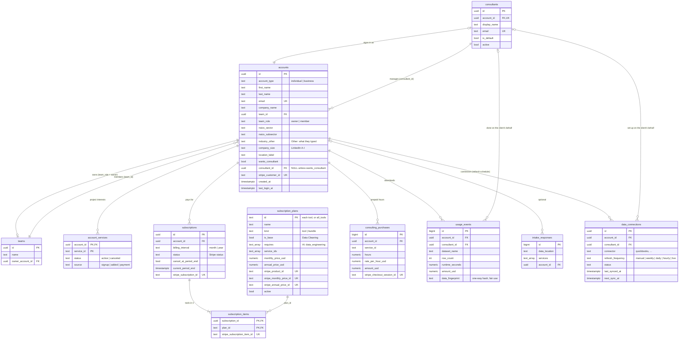

# Database design

One Supabase (PostgreSQL) database, in two layers:

| Layer | File | Holds | Status |
|---|---|---|---|
| **Platform** (`public`) | [`db/schema.sql`](../db/schema.sql) | Who signed up, teams, consultants, plans, subscriptions, consulting hours, usage | ✅ Live (used by the API) |
| **Client data** (`warehouse`) | [`db/warehouse.sql`](../db/warehouse.sql) | Clients' own business data, for Data Engineering clients who opt in to managed storage | 🟡 Designed and tested, not loaded yet ([DATA_MODEL.md](DATA_MODEL.md)) |
| **Planned** | (this page) | QuickBooks connections and syncs, AI usage caps, storage consent | 📝 Proposed below |

Rule of thumb: **the platform layer never holds client data** (uploaded files
are processed in memory). Client data lives only in the warehouse layer, only
for clients who choose managed storage. See ARCHITECTURE.md → "Stateless processing".

Apply or update: Supabase → SQL Editor → paste `db/schema.sql` → Run. Every
statement is safe to re-run.

## Platform layer: ER diagram



## What each table is for (and who writes it)

| Table | One row per | Written by | Notes |
|---|---|---|---|
| `accounts` | person who signed up (client or consultant) | signup, "Add a client" (`api/routers/accounts.py`, `consultants.py`) | Business accounts: the **team owner** holds the plan, consultant and billing for everyone on the team. `industry_other` = "Other" industry text; empty = NULL. |
| `teams` | business | business signup | `accounts.team_id` links members. |
| `consultants` | consultant (a "dim" table) | first consultant sign-in (`consultants.register`) | Email must be in `CONSULTANT_EMAILS`; `is_default` = who "do it for me" clients go to. |
| `account_services` | project a client would like a consultant's help with | signup ("Projects with a consultant" on Your needs) | **Interest only** — doesn't unlock tools (subscriptions do). Shown to the consultant. |
| `subscription_plans` | thing you sell = Stripe product: each **tool**, and the All tools **bundle** | `scripts/sync_stripe.py` | Prices are defined in `api/services/pricing.py`; the script copies them here with the Stripe ids. `is_base` = Data Cleaning (in every package); `requires` = AI needs Data Engineering; `service_ids = '{}'` means every service (the bundle). |
| `subscriptions` | client subscription | **Stripe webhook only** (`api/services/billing.py`) | One billing interval for all its tools. `active`, `trialing`, `past_due` keep it on. Cancel = `cancel_at_period_end` until the period ends, then `canceled`. |
| `subscription_items` | tool in a subscription ("build your own package") | Stripe webhook (replaced as a whole on every change) | The total price is the sum of the items' prices. |
| `consulting_purchases` | paid Checkout for consulting hours | Stripe webhook | The free 30-minute first call isn't a purchase; it's booked through `BOOKING_URL`. |
| `usage_events` | cleaned-file download | download endpoint | Metadata only (name, row count, runtime, amount) — never the data. `consultant_id` set when a consultant downloaded for the client. Amount is $0 when a plan includes Data Cleaning, and for a repeat of the same data. `data_fingerprint` is a one-way SHA-256 hash of the downloaded table, used for fair use (download limit, free repeats — [PAYMENTS.md](PAYMENTS.md#fair-use)); the data can't be rebuilt from it. |
| `data_connections` | client picks a refresh schedule for a connector (Plan & billing → Connected data) | `PUT /api/connections/{connector}/refresh` (later: the sync job) | One row per connector per client: how often it refreshes (`daily` by default; `hourly`/`live` are add-ons — [PRICING.md](PRICING.md)), status, last/next sync. Holds the schedule only — pulled data goes to the warehouse. Needs Data Engineering. |
| `intake_responses` | guest questionnaire | (not used yet) | Analytics: which sources and services people ask for. |

**Who can see what** is enforced by the API (`get_acting_context`, see
ARCHITECTURE.md → Consultants): a client sees their own rows; a consultant sees
the clients whose `consultant_id` is theirs. Row Level Security is switched on
for every table with no public policies, so Supabase's browser API can't read
anything; the API connects with the database password.

## Subscriptions: how a plan gets turned on

```
pricing.py SUBSCRIPTIONS ──(scripts/sync_stripe.py)──► Stripe products + prices (per tool)
                                                       └─► subscription_plans (Stripe ids)
Client picks tools ──► POST /api/billing/checkout ──► Stripe Checkout (one line per tool)
Stripe ──(signed webhook)──► POST /api/billing/webhook ──► subscriptions + subscription_items
Workspace ──► entitlements.active_services ──► the picked tools unlocked
```

Details and setup: [PAYMENTS.md](PAYMENTS.md). Prices: [PRICING.md](PRICING.md).

## Client data layer (managed storage)

Designed in [`db/warehouse.sql`](../db/warehouse.sql) and explained in
[DATA_MODEL.md](DATA_MODEL.md): one shared star schema (`dim_client`,
`dim_date`, `dim_source`, `dim_customer`, `dim_employee`, `dim_product`,
`fact_event`), every row tagged with `client_id`, and Row Level Security so one
client can never see another's rows. Not loaded yet — storing client data is a
deliberate design change, gated by the consent table below.

## Planned tables (proposed — not in schema.sql yet)

Add each one to `db/schema.sql` (and `api/services/account_store.py`) when its
feature is built. Proposed shapes:

### Managed storage consent (Data Engineering)

```sql
-- A client's explicit "yes, store my data" (and when they withdrew it).
CREATE TABLE storage_consents (
    id            BIGSERIAL PRIMARY KEY,
    account_id    UUID NOT NULL REFERENCES accounts (id) ON DELETE CASCADE,   -- plan holder
    consented_at  TIMESTAMPTZ NOT NULL DEFAULT now(),
    withdrawn_at  TIMESTAMPTZ,              -- set -> delete their warehouse rows within 30 days
    terms_version TEXT NOT NULL,            -- which storage terms they agreed to
    consented_by  UUID REFERENCES accounts (id)   -- who clicked (owner, or consultant acting)
);
-- One row per load into the warehouse (cleaned upload or connector sync).
CREATE TABLE load_runs (
    id            BIGSERIAL PRIMARY KEY,
    client_id     UUID NOT NULL,            -- warehouse.dim_client
    source        TEXT NOT NULL,            -- 'upload', 'quickbooks', ...
    rows_loaded   INTEGER NOT NULL DEFAULT 0,
    status        TEXT NOT NULL CHECK (status IN ('running', 'succeeded', 'failed')),
    error         TEXT,
    started_at    TIMESTAMPTZ NOT NULL DEFAULT now(),
    finished_at   TIMESTAMPTZ
);
```

### QuickBooks (and later other connectors)

`data_connections` (above) already exists with the refresh schedule. When
the QuickBooks OAuth work starts, it gains the sign-in columns, plus a log of
every pull:

```sql
-- The connected outside account (added to the existing data_connections table).
ALTER TABLE data_connections
    ADD COLUMN external_id      TEXT,          -- QuickBooks "realmId" (the company)
    ADD COLUMN display_name     TEXT,          -- "Lee Bakery LLC"
    -- OAuth tokens: NEVER plain text. Store the id of a Supabase Vault secret
    -- (or encrypt with a key kept outside the database).
    ADD COLUMN token_secret_id  UUID,
    ADD COLUMN token_expires_at TIMESTAMPTZ;
CREATE UNIQUE INDEX uq_data_connections_external ON data_connections (connector, external_id);
-- One row per sync (what was pulled, and whether it worked).
CREATE TABLE sync_runs (
    id             BIGSERIAL PRIMARY KEY,
    connection_id  UUID NOT NULL REFERENCES data_connections (id) ON DELETE CASCADE,
    trigger        TEXT NOT NULL CHECK (trigger IN ('schedule', 'refresh_now')),
    entities       TEXT[] NOT NULL,         -- {'customers','invoices','payments'}
    rows_pulled    INTEGER NOT NULL DEFAULT 0,
    rows_inserted  INTEGER NOT NULL DEFAULT 0,   -- new values (unified.plan_upsert "insert")
    rows_updated   INTEGER NOT NULL DEFAULT 0,   -- changed values ("update"); unchanged ones are skipped
    status         TEXT NOT NULL CHECK (status IN ('running', 'succeeded', 'failed')),
    error          TEXT,
    started_at     TIMESTAMPTZ NOT NULL DEFAULT now(),
    finished_at    TIMESTAMPTZ
);
```

Without managed storage, a QuickBooks sync still works like an upload: pulled
into memory, joined with the client's files (fuzzy matching on names, emails,
phones — [CONNECTORS.md](CONNECTORS.md)), cleaned, and discarded. With managed
storage, it loads into the warehouse with `dim_source = 'quickbooks'`.

### AI questions (Gemini) with caps

```sql
-- Daily counters per account — enough to enforce caps and see cost. The
-- questions and answers themselves are NOT stored (they can contain client data).
CREATE TABLE ai_usage_daily (
    account_id      UUID NOT NULL REFERENCES accounts (id) ON DELETE CASCADE,   -- plan holder
    usage_date      DATE NOT NULL,          -- in US Eastern time, like the cap resets
    questions       INTEGER NOT NULL DEFAULT 0,
    input_tokens    INTEGER NOT NULL DEFAULT 0,
    output_tokens   INTEGER NOT NULL DEFAULT 0,
    cost_usd        NUMERIC(10, 4) NOT NULL DEFAULT 0,
    PRIMARY KEY (account_id, usage_date)
);
```

Caps would live in `pricing.py` per plan (for example 5 questions a day free,
50 on All tools, unlimited when a consultant is working), checked with one
`INSERT ... ON CONFLICT DO UPDATE ... RETURNING questions` before calling the
model, like the Video Game Stats Tracker's limits. A global monthly spend limit
(`AI_MONTHLY_BUDGET_USD`) is a second safety net.

## Changing the schema

1. Edit `db/schema.sql` with `CREATE TABLE IF NOT EXISTS` / `ADD COLUMN IF NOT EXISTS`
   so it stays safe to re-run.
2. Update `api/services/account_store.py` (both the database and the in-memory path).
3. Update this page (table list and ER diagram).
4. Run it in Supabase's SQL Editor.
