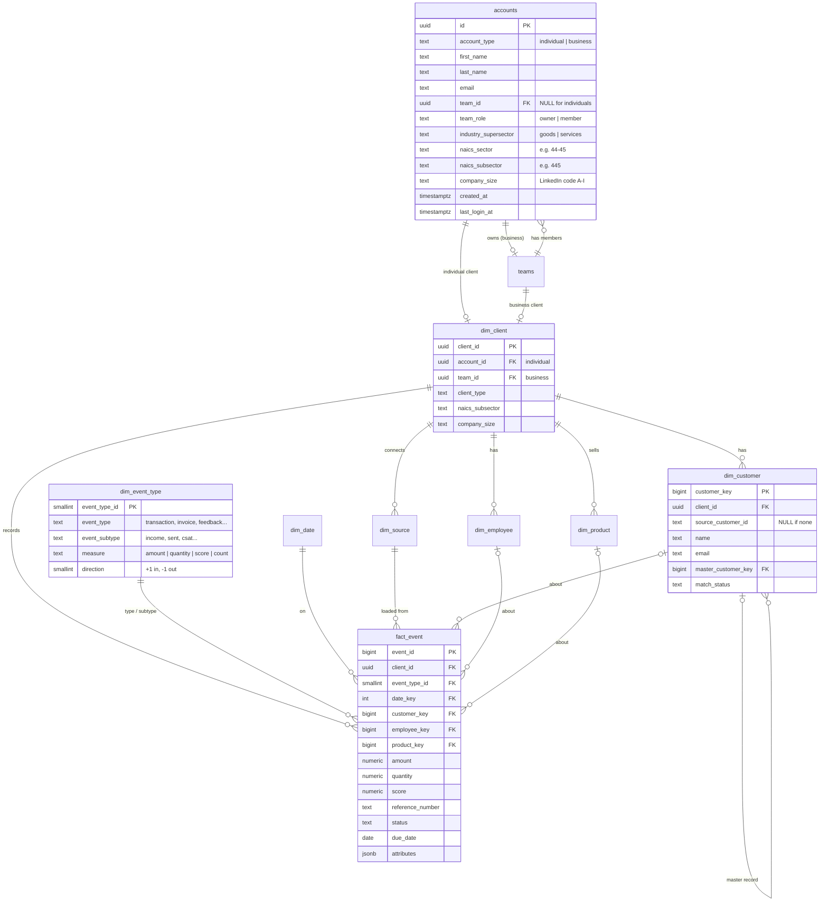

# Data model: many clients, one database

**Question:** *"How would I set up a database if I have different companies and
probably different tables for each company?"*

**Short answer:** don't give each company its own tables. Use **one shared star
schema** where every row carries a `client_id`, keep client-specific extras in a
JSONB `attributes` column, and let Postgres **Row Level Security** keep each
client's rows private. Files: [`db/schema.sql`](../db/schema.sql) (platform) and
[`db/warehouse.sql`](../db/warehouse.sql) (client data). Both were tested on
PostgreSQL 16, including cross-client isolation.

## Why not one set of tables per company?

| Per-company tables | One shared schema (recommended) |
|---|---|
| 50 clients × 8 tables = 400 tables to migrate on every change | 8 tables, one migration |
| Every dashboard/query rewritten per client | One query works for every client (filter by `client_id`) |
| Cross-client benchmarks ("bakeries like you…") need giant UNIONs | `GROUP BY naics_subsector` |
| Easy to point a query at the wrong client's tables | RLS makes leaking another client's rows impossible from the API |
| Different column names per client | Same columns; extras go in `attributes` |

The only time to split is a large client who **contractually** requires their own
database — then they get a copy of the same schema, not a different one.

## Two layers

```
public   (db/schema.sql)     — the PLATFORM: who signed up, teams, usage/billing
warehouse (db/warehouse.sql) — CLIENT DATA, only for Data Engineering clients who opt in
```

The free cleaning flow still stores **no** client data. The warehouse is an
explicit, opt-in service (see "Stateless processing" in ARCHITECTURE.md).

## How your design maps to the tables

| Your idea | Where it lives | Notes |
|---|---|---|
| User table, split individual vs. business, names, IDs, created at, last logged in | `public.accounts` | `account_type`, `created_at`, `last_login_at` (new), industry columns (new) |
| "Do they have a team, and who is on it?" | `accounts.team_id` + `team_role` → `public.teams` | Individuals have `team_id = NULL` |
| Goods vs. services → NAICS sector → subsector | `accounts.industry_supersector`, `naics_sector`, `naics_subsector` | Asked on step 1 of the funnel; copied to `warehouse.dim_client` |
| Business size | `accounts.company_size` | LinkedIn size codes: `A` self-employed, `B` 1–10, `C` 11–50, `D` 51–200, `E` 201–500, `F` 501–1,000, `G` 1,001–5,000, `H` 5,001–10,000, `I` 10,001+ employees. Asked on step 1; copied to `warehouse.dim_client` so benchmarks can compare similar-sized businesses |
| Services the client has | `public.account_services` | One row per service on an account's plan (the team owner's, for businesses); drives the workspace's left pane. See `docs/PRICING.md` |
| Fact table with ID, type, subtype, date | `warehouse.fact_event` + `dim_event_type` | Type/subtype are a lookup table, so a new kind of event is a new **row**, not a new column or table |
| Expenses, income | `dim_event_type` rows `transaction/income`, `transaction/expense` | `direction` (+1 / −1) makes net cash a single `SUM(amount * direction)` |
| CSAT score, rating | rows `feedback/csat`, `feedback/rating`, `feedback/nps` | Stored in `fact_event.score` |
| Employee | `warehouse.dim_employee` + events `employee/hire`, `employee/termination`, `payroll/gross_pay` | |
| Invoice received / sent | events `invoice/received`, `invoice/sent`, `invoice/paid` | Invoice #, status, due date are columns on the fact |
| Customer table | `warehouse.dim_customer` | With source IDs **and** fuzzy-match fields (below) |
| Invoice type table, feedback table | *Not needed as separate tables* | They are rows in `dim_event_type`. Add a dedicated dimension only when a thing has many descriptive fields of its own (as customers and employees do). |

## ER diagram



## The grain: one row per event, at the smallest level available

| Business event | event_type / subtype | Measure | Links |
|---|---|---|---|
| A café sells a $4.50 latte | transaction / income | amount 4.50 | product, customer (if known) |
| Rent paid | transaction / expense | amount 2,000 | — |
| Invoice #1001 sent to Acme | invoice / sent | amount 450, status "open", due date | customer |
| Acme pays #1001 | invoice / paid | amount 450 | customer |
| Survey response, 4 of 5 | feedback / csat | score 4 | customer |
| Maria hired | employee / hire | count | employee |
| Pay run | payroll / gross_pay | amount 12,300 | employee (one row per employee per run) |

If a source only has monthly totals, load monthly totals — the grain is "the
smallest the source provides". Record it in `attributes` (e.g. `{"grain": "month"}`).

## Loading data safely

- `(client_id, source_id, source_record_id)` is unique, so re-loading the same
  file or re-syncing QuickBooks uses `INSERT ... ON CONFLICT DO NOTHING` and never
  creates duplicates.
- Every row keeps `source_id`, so you can always answer "where did this number come from?".

## Customers without IDs (fuzzy matching)

QuickBooks has customer IDs; a client's spreadsheet often doesn't. When a new
customer row arrives without an ID that matches:

1. exact email → same customer (`match_status = 'exact_email'`)
2. exact phone → same customer (`'exact_phone'`)
3. fuzzy name ≥ 92 → same customer (`'fuzzy_auto'`); 80–91 → queued for a person to
   confirm (`'fuzzy_reviewed'` once confirmed)
4. otherwise a new customer (`'unmatched'`)

Matched rows point at one `master_customer_key`, so reports count each real
customer once. Code: `api/services/entity_matching.py`.

## Privacy: Row Level Security (tested)

Each warehouse table has a policy `client_id = current_setting('app.client_id')`.
The API sets `SET LOCAL app.client_id = '<uuid>'` inside each transaction.
Verified on PostgreSQL 16 with a non-superuser role:

- client A's session sees only client A's rows;
- with no client set, **zero** rows are visible;
- inserting a row tagged with another client's ID is **rejected**.

Use a dedicated non-superuser role for the API (grants are at the bottom of
`db/warehouse.sql`); superusers bypass RLS.

## Industry benchmarks (why we ask for NAICS)

Because every client is in the same tables with a NAICS subsector, you can
compare a client to anonymized peers in one query, e.g. average invoice size for
all `naics_subsector = '722'` (restaurants). Only show peer groups of 5+ clients
so no single business can be identified.

## Growing later

- **Hundreds of millions of events:** partition `fact_event` by `date_key` range.
- **A client needs a field everyone will need:** promote it from `attributes`
  to a real column (one migration, all clients benefit).
- **Dedicated database for one big client:** same schema, separate instance.
