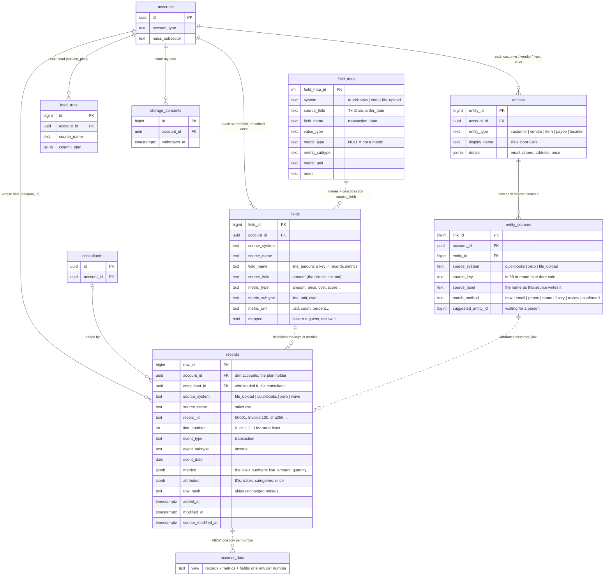

# Data model: every client's data in one shape

**Question:** *"How would I set up a database if I have different companies and
probably different tables for each company?"*

**Short answer:** don't give each company its own tables. Store **every
client's data in one table**, `fact.account_data`, in one shape: IDs, dates and
categories kept exactly as they are, and every number that is measured turned
into its own row described by `metric_type`, `metric_subtype`, `metric_unit`
and `metric_value`. Every row carries the `account_id` it belongs to, and
Postgres **Row Level Security** keeps each client's rows private. File:
[`db/schema.sql`](../db/schema.sql) (the `fact` schema). Tested on PostgreSQL 16,
including cross-client isolation.

## Why not one set of tables per company?

| Per-company tables | One shared table (this design) |
|---|---|
| 50 clients × 8 tables = 400 tables to migrate on every change | 1 table, one migration |
| Every dashboard/query rewritten per client | One query works for every client (filter by `account_id`) |
| Cross-client benchmarks ("bakeries like you…") need giant UNIONs | `GROUP BY` the NAICS subsector |
| Easy to point a query at the wrong client's tables | RLS makes leaking another client's rows impossible from the API |
| Different column names per client | Shared names (`field_map`); each client's own name kept in `source_field` |

The only time to split is a large client who **contractually** requires their own
database — then they get a copy of the same schema, not a different one.

## Two schemas

```
dim   (db/schema.sql) — the PLATFORM: who signed up, consultants, plans, consent, load log
fact  (db/schema.sql) — CLIENT DATA, only for Data Engineering clients who opt in:
                        records (one row per record line) + fields (each field described
                        once) + field_map (shared names); account_data = a VIEW of them
```

## How it's stored: no repetition (records + fields)

The data is stored as **one row per record line** (`fact.records`): the line's
IDs, dates and categories once in `attributes`, and **all its numbers together**
in `metrics` (`{"quantity": 3, "unit_price": 7.0, "line_amount": 21.0}`). What
each number measures is written **once per source** in `fact.fields`
(`line_amount` = the client's `amount` column, metric_type `amount`, subtype
`line`, unit `usd`). Rows grow with records — never records × numbers — and a
new source with new columns needs no table change.

| The sample bakery file (1.7 MB CSV, 18,210 records) | Rows | Size with indexes |
|---|---|---|
| First design: one row per number, details copied onto each | 54,630 | ~40 MB |
| **Now: `fact.records` + `fact.fields`** | **18,210** (+ 3 field rows) | **~17 MB** |

Measured on PostgreSQL 16 (10/2026). **`fact.account_data` is now a VIEW** that
shows the one-row-per-number shape below (each record × its numbers, with the
field descriptions), so queries like "every amount in usd from any source"
keep working. Inside the app, `api/services/warehouse_store.py` packs the
unified rows into records when it saves (`_pack`) and unpacks them when it
reads (`_unpack`), so the rest of the code still works with one row per number.

The free cleaning flow still stores **no** client data. Storing it is an
explicit, opt-in service (see "Managed storage" in ARCHITECTURE.md). The `dim`
tables are described in [DATABASE.md](DATABASE.md).

## How your design maps to the tables

| Your idea | Where it lives | Notes |
|---|---|---|
| User table, split individual vs. business, names, IDs, created at, last logged in | `dim.accounts` | `account_type`, `created_at`, `last_login_at`, industry columns |
| "Do they have a team, and who is on it?" | `dim.accounts.team_id` + `team_role` → `dim.teams` | Individuals have `team_id = NULL` |
| Goods vs. services → NAICS sector → subsector | `dim.accounts.industry_supersector`, `naics_sector`, `naics_subsector` | Asked on step 1 of the funnel |
| Location (optional, signup only) | `dim.accounts.location_*` | Picked from a city list (GeoNames); only the id is trusted |
| Business size | `dim.accounts.company_size` | LinkedIn size codes `A` (self-employed) … `I` (10,001+ employees) |
| What a client pays for | `dim.subscriptions` (its tools in `items`) | Projects they'd like help with: `dim.accounts.interested_services` (interest only) |
| Fact table with ID, type, subtype, date | `fact.records` | `record_id`, `event_type` / `event_subtype` (what the rows are), `event_date` |
| "Unified data": IDs, dates and categories as they are, metrics pivoted into type / value / unit / subtype | `fact.records.metrics` + `fact.fields` (the `fact.account_data` view shows one row per metric) | Each line's IDs, dates and categories ONCE in `attributes`; each field's type / subtype / unit ONCE in `fact.fields` |
| Expenses, income | `event_type` / `event_subtype` = `transaction/income`, `transaction/expense` | In an expense an `amount` is described as a **cost** |
| CSAT score, rating | `feedback/csat`, `feedback/nps` rows; `metric_type = 'score'` | `csat` and `nps` columns become two rows, subtypes `csat` / `nps` |
| Invoice received / sent | `invoice/received`, `invoice/sent`, `invoice/paid` | Invoice #, status, due date ride along in `attributes` |
| Customer table, product list | `list/records` rows (no numbers): one row per record with all its details | The same table; no separate customer or product tables |
| QuickBooks fields with different names | `fact.field_map` | `TxnDate` → `transaction_date`, `Line.Amount` → `line_amount` (amount / line / usd) |

## ER diagram



## Unified data: one shape for every source

```
wide (the client's file)                                 fact.account_data (one row per metric)
order_id | date       | store   | qty | unit_price | amount     field_name  | metric_type | metric_subtype | metric_unit | metric_value | source_field | attributes
50001    | 2024-10-11 | Midtown | 3   | 7.00       | 21.00  ->  quantity    | quantity    |                | count       | 3            | qty          | {reference_number: 50001, transaction_date: 2024-10-11, location_name: Midtown}
                                                                unit_price  | price       | unit           | usd         | 7.00         | unit_price   | (same)
                                                                line_amount | amount      | line           | usd         | 21.00        | amount       | (same)
```

**How the pieces fit** (code: `api/services/unified.py`; the load:
`warehouse_loader.py` plans it, `warehouse_store.py` writes it):

| Piece | What it does |
|---|---|
| `fact.field_map` (table) + `QUICKBOOKS_FIELD_MAP` / `FILE_UPLOAD_FIELD_MAP` (code) | Lines names up across sources (QuickBooks `TxnDate` and a file's `order_date` both become `transaction_date`) **and** says which fields are metrics and what they measure (`Line.Amount` → amount / line / usd). A test keeps the table seed and the code identical. |
| `classify_metric()` | Describes a number column nobody mapped yet from the words in its name (`shipping_cost` → cost / shipping / usd), with a confidence. Low or medium = a person reviews it (the preview shows it; the `unified-metrics` skill too). |
| `attributes` (JSONB) | Everything that is not a metric — IDs, dates, categories, names — kept as is, by shared name, on every metric row of its record line. Filter with `attributes->>'location_name'` (indexed). |
| `flatten_quickbooks()` / `dataframe_to_unified()` | Turn a QuickBooks API object or a cleaned file into rows. QuickBooks header fields are line 0, its `Line` items lines 1, 2, 3. A file whose order number repeats (one row per item) is numbered the same way. |
| `unified_to_wide()` / `round_trip()` | Pivot back to a normal table and compare every cell with the original. The preview refuses to load if the round trip fails, and "Use my stored data" uses the same pivot to give the client their table back with their own column names (from `dim.load_runs.column_plan`). |
| `record_id` + `row_hash` + the upsert | No duplicates: the source's ID (or a fingerprint of the row), a unique key per metric, and a content fingerprint, so an unchanged reload writes nothing and a changed value updates one row. |
| `spark_engine.melt_to_unified()` | The same reshape in Spark, for tables too big for pandas ([SPARK.md](SPARK.md)). |

**Rules that need context, not just the column name:**

- In an expense (a QuickBooks Purchase, or a file with a `vendor` / `expense…`
  column), `amount` is money going out, so it becomes a **cost**. From the event
  it's certain; from column names it's flagged for a person to confirm.
- A record in another currency (QuickBooks `CurrencyRef`) gets that unit (`cad`)
  instead of `usd`. **Never sum across units** — filter on `metric_unit`.
- A line with no numbers at all (a customer list, a description-only QuickBooks
  line) gets one row with `field_name = '_no_metric'`, so its details are kept.
- Numbers that only count positions (QuickBooks `LineNum`) or name things
  (`order_id`, `zip`) are kept as attributes, not metrics.
- A date column with a few non-dates ("TBD") is still the date column; the odd
  values are kept as written, and those rows have no `event_date`.
- Negative numbers stay negative (a refund line is −4.00): nothing is changed,
  only reshaped.

**Test a client's file without storing it** — the `unified-metrics` skill
(Data Engineering) runs the same code:

```bash
python -m data_skills run unified-metrics samples/sales.csv
python -m data_skills run unified-metrics samples/expenses.csv --param event=transaction/expense
```

It also writes `sql_field_map`: ready-made `fact.field_map` rows for a file's
new columns, so the next file with the same headers is mapped automatically.

## The grain: one record line at the smallest level available (its numbers together)

| Business event | event_type / subtype | Numbers on the record (the view shows one row each) |
|---|---|---|
| A café sells 2 lattes at $4.50 | transaction / income | `quantity` 2, `unit_price` 4.50, `line_amount` 9.00 |
| Rent paid | transaction / expense | `line_amount` 2,000 (cost / line / usd) |
| Invoice #1001 sent to Acme (2 lines) | invoice / sent | line 0: `total_amount`, `balance_due`; lines 1–2: `quantity`, `unit_price`, `line_amount` |
| Survey response, CSAT 4, NPS 9 | feedback / csat | `csat` 4 (score / csat), `nps` 9 (score / nps) |
| A customer list | list / records | none: one record per customer, `metrics` = `{}`, all details in `attributes` |

If a source only has monthly totals, load monthly totals — the grain is "the
smallest the source provides".

## Loading data safely

- **Preview first:** the client sees each column's role, each metric's
  description, every step with its *why*, the first rows as stored and the
  round-trip check; nothing is stored until "Accept and load" — and only if
  the data and choices still match the preview (its fingerprint).
- `(account_id, source_system, source_name, record_id, line_number)` is unique
  in `fact.records`. One statement inserts new lines, **skips** lines whose
  `row_hash` is unchanged, and **updates** lines whose content changed
  (`modified_at` moves, `added_at` never does). Tested on PostgreSQL: reloading
  the sales sample wrote nothing; changing 3 amounts updated 3 lines (9 numbers);
  the same data under another file name was caught as duplicates.
- **The same spreadsheet, uploaded again** (rows or columns added — many clients
  keep one file and keep adding to it): the preview compares it with the copy
  stored under that name, by record, and says what's new ("120 new rows, 3
  changed, new column: store" — `warehouse_store.changes_since_stored`); one
  click ("Update my stored data") adds the new rows and updates the changed
  ones. Rows no longer in the file stay stored; "Update my most recent upload"
  (Settings) replaces the file completely.
- Every record keeps `source_name`, and every field its `source_field` (in
  `fact.fields`), so you can always answer "where did this number come from?".

## Entities: each customer stored once (and matched across sources)

Before: a customer's name, email and address were copied onto every metric
row of every invoice, and "Blue Door Cafe" from QuickBooks and "BLUE DOOR
CAFE LLC" from a spreadsheet were unrelated text. Now (`api/services/entities.py`):

| Table | One row per | Holds |
|---|---|---|
| `fact.entities` | one real customer, vendor, product, payee or store location | type, display name, details (email, phone, address) — once |
| `fact.entity_sources` | one way a source refers to it | "QuickBooks customer 58" / "file_upload: name blue door cafe" → the entity, and how it was matched |
| `fact.account_data` | one metric (as before) | attributes hold `customer_link` (an entity_sources id) instead of the name, ID and details |

**Matching a new mention**, most confident first: the same source already
linked it → same email → same phone → same normalized name ("Acme Bakery,
LLC" = "acme bakery") → a fuzzy name ≥ 92% alike. 80–91% makes a NEW entity
with the other one suggested: a person answers "Is this the same customer?"
(`GET/POST /api/entities/review`). Rows point at the SOURCE's link, not the
entity, so merging re-points one row: no stored metric changes, and each
source still gets its own spelling back.

**Reading back:** "Use my stored data" puts each source's names and IDs and
the entity's details back (`entities.expand`), so the table looks as loaded.
Details are kept once per customer (the first value seen).

**Customers across sources in SQL:**

```sql
SELECT e.display_name AS customer, SUM(a.metric_value) AS revenue
FROM fact.account_data a
JOIN fact.entity_sources s ON s.link_id = (a.attributes->>'customer_link')::bigint
JOIN fact.entities e ON e.entity_id = s.entity_id
WHERE a.account_id = '<account uuid>' AND a.field_name = 'line_amount'
GROUP BY e.display_name ORDER BY revenue DESC;
```

Unstored data (the quick look, "Add another source") is matched in memory
when read, as before (`api/services/entity_matching.py`).

## Duplicates across sources

Within one source the unique key and `row_hash` prevent duplicates. Across
sources (QuickBooks syncing the invoices, and an exported file of the same
invoices) the IDs differ, so `api/services/dedupe.py` compares what records
say: **money in / out, date, amount** (total; else payment; else the sum of
the lines) **and the reference number** when both have one. The load preview
shows "N of these records are already stored from QuickBooks Online" with
"load only the new records" (default). The stored sync reports how many
synced records were also in uploaded files.

## Privacy: Row Level Security (tested)

`fact.account_data` has the policy `account_id = current_setting('app.account_id')`,
forced for the table owner too. The API sets it with
`set_config('app.account_id', '<uuid>', true)` inside each transaction **and**
filters every query by `account_id`. Verified on PostgreSQL 16 with a login
that doesn't bypass RLS:

- the owning account's session sees its rows;
- another account, or no account set, sees **zero** rows.

The API's own login (Supabase's `postgres`) can bypass RLS — it needs to, to
read the `dim` tables — which is why every query also names the account.

## Industry benchmarks (why we ask for NAICS)

Because every client is in the same table, and `dim.accounts` has the NAICS
subsector, you can compare a client to anonymized peers in one query, e.g.
average invoice size for all restaurants (`naics_subsector = '722'`). Only show
peer groups of 5+ clients so no single business can be identified.

## Growing later

- **Hundreds of millions of rows:** partition `account_data` by `account_id`
  hash or `event_date` range.
- **A field everyone needs:** promote it from `attributes` to a real column
  (one migration, all clients benefit).
- **Fast dashboards on huge data:** a materialized view per common question
  (monthly revenue by store), refreshed after each load.
- **Dedicated database for one big client:** same schema, separate instance.

## Wave in the unified model

`WAVE_FIELD_MAP` / `flatten_wave_invoice()` (`api/services/unified.py`, seeded
in `fact.field_map` as system `wave`): each Wave invoice is invoice/sent; the
invoice is line 0 (`total.value` → total_amount, `amountDue.value` →
balance_due, `taxTotal.value` → tax_amount, `customer.*` → customer_*) and its
`items` are lines 1, 2, 3 (`subtotal.value` → line_amount, `quantity`,
`unitPrice`, `product.*` → item_*). Drafts aren't stored.

## Xero in the unified model

`XERO_FIELD_MAP` / `flatten_xero()` in `api/services/unified.py` (seeded in
`fact.field_map` with system `xero`): invoices (ACCREC = invoice/sent,
ACCPAY = invoice/received), bank transactions (RECEIVE = income, SPEND =
expense; transfers not stored) and payments. The header is line 0 and
`LineItems` are lines 1, 2, 3, like QuickBooks' `Line`. On bills, money
spent and bill payments the contact is a supplier (`vendor_*`), else a
customer. Drafts, voided and deleted records aren't stored, and a record
voided later is removed by the next sync.
